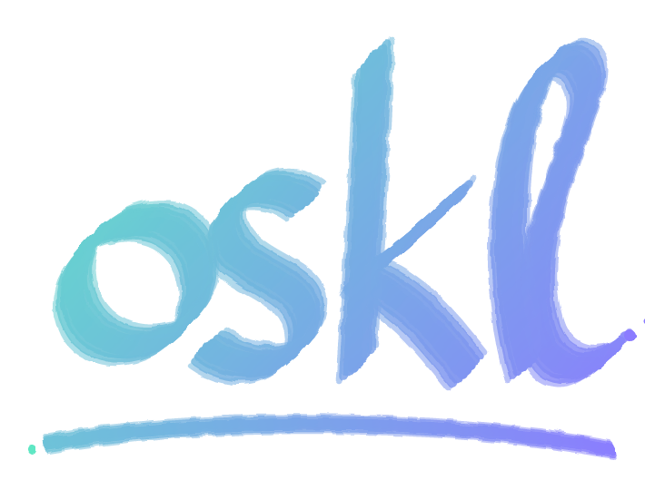

<p align="center">
  
</p>

<p align="center">
  A fast, lightweight, git-first code editor for macOS.<br>
  Native Rust on GPUI (the GPU UI framework behind Zed). No Electron, no extensions to install.
</p>

---

## Why OSKL Code

| | OSKL Code | Typical Electron editor |
|---|---|---|
| Memory with a project open | ~100 MB | 500 MB – 1.5 GB |
| App size | ~20 MB | 300+ MB |
| Startup | instant (native, GPU-drawn) | seconds |
| Git tools | built in: graph, blame, editable diffs, merge editor | extensions |
| Terminal | real terminal (alacritty) in any split | panel at the bottom |

- **Light on your Mac.** One native process, no web runtime. Big repos and many splits stay smooth.
- **Git first.** Commit, stage, discard, branch graph, blame, side-by-side and editable diffs, a 3-way merge editor, several repositories per workspace.
- **Splits instead of tabs.** Tile files and terminals the way tmux / iTerm do, and move between them from the keyboard.
- **Familiar keys.** VS Code shortcuts, plus readline/emacs keys and a `:` command line for people who like Vim.
- **Works with your tools.** Formats and lints with the formatter your project already uses (Prettier, Biome, ESLint, rustfmt, gofmt, ruff…).

## Install

**Requirements:** macOS 13 or later (Apple Silicon or Intel), [Rust](https://rustup.rs) (stable), Xcode Command Line Tools, and `git`.

```bash
# 1. Tools (skip what you already have)
xcode-select --install
curl --proto '=https' --tlsv1.2 -sSf https://sh.rustup.rs | sh

# 2. Get the code
git clone https://github.com/oussama-krittel/oskl-code.git
cd oskl-code

# 3. Build the app and install it to /Applications
./packaging/build-app.sh
```

The script builds a release binary, makes the icon, wraps everything in `OSKL Code.app`, signs it for your Mac (ad-hoc) and copies it to `/Applications`. To install somewhere else, pass the folder: `./packaging/build-app.sh ~/Applications`.

The first build takes a few minutes; later builds are quick. To update, `git pull` and run the script again.

### Open it from the terminal

```bash
open -a "OSKL Code" .                 # this folder
open -a "OSKL Code" ~/code/my-app     # any folder
```

Or add a shortcut to your `~/.zshrc`:

```bash
oskl() { open -a "OSKL Code" "${1:-.}"; }
```

### Run without installing

```bash
cargo run --release -- /path/to/project            # a folder
cargo run --release -- /path/to/project src/app.ts # a folder and a file
```

## Getting started

1. **Open a folder:** ⌘O, drag a folder onto the Dock icon, or pick one from the recent list on the welcome screen. ⌘⇧N opens another project in a new window and ⌘\` switches between them.
2. **Find a file:** ⌘P, type a few letters (fuzzy). Add `:42` to jump to a line: `app.ts:42`.
3. **Split the screen:** ⌘\\ splits right, ⌘⇧\\ splits down. ⌘⌥ + arrows move between splits. Drag the gap to resize.
4. **Open a terminal:** ⌘T in the focused split, or ⌃\` for one at the bottom.
5. **Commit:** ⌃⇧G opens Source Control. Write a message, ⌘Enter commits.
6. **See every shortcut:** ⌘K ⌘S (the keyboard icon at the bottom of the activity bar). The list is searchable.

## Usage guide

### Explorer (⇧⌘E)

Works like VS Code's:

- Single click previews a file and keeps the keyboard in the explorer; double-click or Enter opens it for editing.
- Right-click for New File / New Folder, Rename (F2), Delete (⌘⌫, moves to the Trash after asking), Cut / Copy / Paste (⌘X ⌘C ⌘V), Duplicate, Copy Path, Reveal in Finder, Open in Terminal.
- Files are colored by git status; ignored files are dimmed.
- **Add Folder to Workspace…** (right-click, the activity-bar button, or `:add-folder`) adds another root folder. Added folders are remembered with the project.

### Source Control (⌃⇧G)

- Changes grouped by folder: stage / unstage / discard on hover or from the keyboard. Discard asks first.
- Commit box: ⌘Enter commits, with an amend toggle.
- Graph with branches, remotes and tags; filter which branches it shows. Fetch, pull and push buttons.
- Click a commit to see its files and diffs; right-click it to create a branch there, cherry-pick, revert or copy its hash.
- **Several repositories:** if your folder (or an added folder) contains more than one git repository, a select at the top of the panel picks which one you see. Changes, graph, commit box and git commands follow it.
- Merge conflicts open in a merge editor; files with no conflict markers left are staged when you save.

### Diffs and blame

- Side by side or inline (⌘K I), with word-level highlights. F7 / ⇧F7 jump between changes.
- Unstaged changes open as editable diffs: edit the right side and ⌘S saves.
- Blame for the current line inline, a blame gutter with ⌥⌘B, and `b` in diffs. Click a blame entry to open that commit.

### Editing

- VS Code keys: ⌘D adds the next match, ⌥↑ ⌥↓ move lines, ⌘/ comments in the file's language, ⌘⇧K deletes a line, and more.
- **Go to definition:** ⌘-click or F12 on a name, an import, or an import path. ⌃- goes back, ⌃⇧- forward (or the ← → buttons in the split header). Hold ⌘ to see what's clickable.
- **HTML / JSX / React Native:** `>` closes the tag, `</` finishes it, suggestions for tags, props, types and import paths (it reads `tsconfig` / `jsconfig` path aliases).
- Search in the file with ⌘F; search and replace across files with ⌘⇧F (match case, whole word, regex, include/exclude globs).
- Auto save is on (1 second after you stop typing). ⌘S formats with your project's formatter first.

### Splits and terminals

- Each split keeps its own list of open files, numbered in its header: ⌘1…⌘9 shows one, ⌘E lists them, ⌘W closes the shown one, ⌘⇧W closes the split.
- ⌘⌥⇧ + arrows moves the shown file or terminal into the next split. You can also drag files between splits or from the explorer; dropping near an edge makes a new split.
- ⌘⌥Enter (or double-click a split header) maximizes a split and back.
- The terminal is a full terminal (vim, htop, less, mouse and scrolling work). ⌘-click a `file:line` it printed to open it.

### Command line (⌘⇧P or ⌘;)

Type commands; Tab completes paths and branches:

| Command | What it does |
|---|---|
| `w`, `q`, `e <file>`, `new`, `mkdir`, `mv`, `cp`, `rm` | Files |
| `format`, `lint` | Run your project's formatter / linter |
| `stage`, `unstage`, `discard`, `commit <msg>`, `push`, `pull`, `fetch`, `sync` | Git |
| `checkout <branch>`, `branch <name>`, `merge`, `rebase`, `stash`, `abort` | Branches |
| `git <anything>` | Any git command; output in the output panel (⌘J) |
| `!<shell command>` | Run a shell command in the project |
| `open <dir>`, `window <dir>`, `recent`, `add-folder <dir>` | Projects and workspaces |
| `sidebar left\|right`, `autosave on\|off`, `keys` | Settings |

### Settings

Settings are stored in `~/.config/kite/settings` as plain `key = value` lines (`sidebar`, `font_size`, `autosave`, `formatonsave`, `blame`, `wrap`). Most of them can also be changed from the status bar or the command line. Each project's layout (splits, open files, terminals, added folders) is saved and restored when you reopen it.

## Development

```bash
cargo run -- .        # debug build, opens this repo
cargo test            # unit and UI tests (the UI tests use real clicks and keystrokes)
```

| Path | What's there |
|---|---|
| `src/workspace.rs` | Window: splits, tabs, command line, status bar, sessions |
| `src/editor.rs`, `src/buffer.rs` | Text editor (rope buffer, multi-cursor, completion, go to definition) |
| `src/file_tree.rs` | Explorer |
| `src/git.rs`, `src/repo.rs`, `src/git_panel.rs`, `src/graph.rs` | Git commands, repository state, Source Control panel, commit graph |
| `src/diff_view.rs`, `src/diff_edit.rs`, `src/merge_view.rs`, `src/commit_view.rs` | Diffs, merge editor, commit pages |
| `src/terminal.rs` | Terminal (alacritty_terminal) |
| `src/search.rs`, `src/findbar.rs` | Search across files, find in file |
| `src/complete.rs`, `src/definition.rs` | Suggestions, tag closing, go to definition |
| `packaging/build-app.sh` | Builds and installs the `.app` |

GPUI compiles its Metal shaders when the app starts (the `runtime_shaders` feature), so you don't need to download the Metal toolchain. To precompile them instead, run `xcodebuild -downloadComponent MetalToolchain` and remove that feature in `Cargo.toml`.

## Status

OSKL Code is young and used daily by its author. It runs on macOS only. There's no extension system or language server support yet: suggestions and go to definition are built in and focus on JavaScript / TypeScript / JSX. Issues and pull requests are welcome.

## License

[MIT](LICENSE) © 2026 Oussama Krittel
