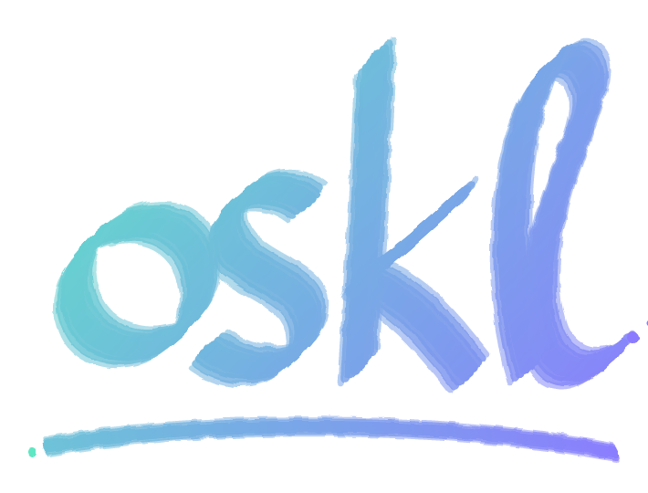

<p align="center">
  
</p>

<p align="center">
  A fast, lightweight, git-first code editor for macOS.<br>
  Native Rust on GPUI (the GPU UI framework behind Zed). No Electron, no extensions to install.
</p>

---

## Why OSKL Code

| | OSKL Code | Typical Electron editor |
|---|---|---|
| Memory with a project open | ~130 MB | 500 MB – 1.5 GB |
| App size | ~55 MB | 300+ MB |
| Startup | instant (native, GPU-drawn) | seconds |
| Git tools | built in: graph, blame, editable diffs, merge editor | extensions |
| Terminal | real terminal (alacritty) in any split | panel at the bottom |

- **Light on your Mac.** One native process, no web runtime. Big repos and many splits stay smooth.
- **Git first.** Commit, stage, discard, branch graph, blame, side-by-side and editable diffs, a 3-way merge editor, several repositories per workspace.
- **Splits instead of tabs.** Tile files and terminals the way tmux / iTerm do, and move between them from the keyboard.
- **Familiar keys.** VS Code shortcuts, plus readline/emacs keys and a `:` command line for people who like Vim.
- **Works with your tools.** Formats and lints with the formatter your project already uses (Prettier, Biome, ESLint, rustfmt, gofmt, ruff…).

## Install

**Requirements:** macOS 13 or later (Apple Silicon or Intel), [Rust](https://rustup.rs) (stable), Xcode Command Line Tools, and `git`.

```bash
# 1. Tools (skip what you already have)
xcode-select --install
curl --proto '=https' --tlsv1.2 -sSf https://sh.rustup.rs | sh

# 2. Get the code
git clone https://github.com/oussama-krittel/oskl-code.git
cd oskl-code

# 3. Build the app and install it to /Applications
./packaging/build-app.sh
```

The script builds a release binary, makes the icon, wraps everything in `OSKL Code.app`, signs it for your Mac (ad-hoc) and copies it to `/Applications`. To install somewhere else, pass the folder: `./packaging/build-app.sh ~/Applications`.

The first build takes a few minutes; later builds are quick. To update, `git pull` and run the script again.

### Open it from the terminal

```bash
open -a "OSKL Code" .                 # this folder
open -a "OSKL Code" ~/code/my-app     # any folder
```

Or add a shortcut to your `~/.zshrc`:

```bash
oskl() { open -a "OSKL Code" "${1:-.}"; }
```

### Run without installing

```bash
cargo run --release -- /path/to/project            # a folder
cargo run --release -- /path/to/project src/app.ts # a folder and a file
```

## Getting started

1. **Open a folder:** ⌘O, drag a folder onto the Dock icon, or pick one from the recent list on the welcome screen. ⌘⇧N opens another project in a new window and ⌘\` switches between them. To tell the windows apart, give each project a color for its title and status bars: click the project's name at the top left and pick one, or Custom… to type a hex color there (the bars follow as you type; Enter keeps it, Esc goes back). From the command line: `:window-color #rrggbb`, `:window-color off`. The project keeps it.
2. **Find a file:** ⌘P, type a few letters (fuzzy). Add `:42` to jump to a line: `app.ts:42`. ⌘⇧O (or `@` first in ⌘P) lists the file's functions, classes and types to jump to (for CSS, HTML, YAML, TOML and JSON: selectors and @media, elements with an id and headings, keys); the breadcrumb shows the one the cursor is in.
3. **Split the screen:** ⌘\\ splits right, ⌘⇧\\ splits down. ⌘⌥ + arrows move between splits. Drag the gap to resize.
4. **Open a terminal:** ⌘T in the focused split, or ⌃\` for one at the bottom.
5. **Commit:** ⌃⇧G opens Source Control. Write a message, ⌘Enter commits.
6. **See every shortcut:** ⌘K ⌘S (the keyboard icon at the bottom of the activity bar). The list is searchable. Pause after ⌘K and the keys that can follow it are listed.
7. **Focus:** ⌘K Z (or `:zen`) hides everything but the editor; Esc or the same keys bring it back. In a narrow window the sidebar lies over the editor and splits stack.

## Usage guide

### Explorer (⇧⌘E)

Works like VS Code's:

- Single click previews a file and keeps the keyboard in the explorer; double-click or Enter opens it for editing.
- Right-click for New File / New Folder, Rename (F2), Delete (⌘⌫, moves to the Trash after asking), Cut / Copy / Paste (⌘X ⌘C ⌘V), Duplicate, Copy Path, Reveal in Finder, Open in Terminal.
- Files are colored by git status; ignored files are dimmed.
- **Add Folder to Workspace…** (right-click, the activity-bar button, or `:add-folder`) adds another root folder. Added folders are remembered with the project.

### Source Control (⌃⇧G)

- Changes grouped by folder: stage / unstage / discard on hover or from the keyboard. Discard asks first.
- Commit box: ⌘Enter commits, with an amend toggle. If git has a `commit.template`, the empty box starts from it.
- Graph with branches, remotes and tags; filter which branches it shows. Fetch, pull and push buttons.
- **Search the graph** (the magnifier, or `:find <text>`): commits on any branch whose message or author contains the text, or whose hash starts with it. Esc shows everything again.
- Click a commit to see its files and diffs. Right-click it to:
  - check it out, branch from it, or tag it;
  - cherry-pick it (with or without committing) or revert it;
  - reset the current branch there: keep the changes staged, keep them unstaged, or discard them (that last one asks first);
  - start an **interactive rebase** from it: pick, reword (edit the message), squash, fix up, drop or move each commit;
  - save it as a `.patch`;
  - compare it with HEAD, or mark it and compare it with another commit.
- **The Git tab** (`:repo`, or the ⤢ on the Repository section): a full git client in the editor area.
  - **Toolbar:** fetch, pull and push (with how many commits each would bring), stash, pop, new branch, "All branches" for the history, apply a patch, and search.
  - The history reads 800 commits at a time and loads more as you scroll to its end (the sidebar's graph too).
  - While the tab is open it fetches every 10 minutes, quietly, so ahead/behind and remote branches stay current.
  - Under the commit box, the subject's length (orange past 72).
  - Click a branch, remote branch or tag in the tree to select its commit (the history widens to every branch if it has to). The sidebar's graph does the same.
  - Right-click a changed file for open, file history, stage or unstage, discard, copy path. A conflicted one opens in the merge editor, or takes ours or theirs whole.
  - **Left:** the branches tree (described below).
  - **Middle:** the history as a table (graph, message, author, date, hash).
  - **Bottom:** the picked commit's details and files, with the diff of the file you click beside them. ↑ / ↓ move through the history, Enter opens the commit.
  - **Local changes** (the first row, when there are any): conflicted, unstaged and staged files, each staged, unstaged or discarded on hover, or all at once. Click a file for its diff; an unstaged one is editable, with its hunks and lines staged from there. Below, a commit box (⌘Enter) with Amend, which starts from the last commit's message.
  - **A merge, rebase or cherry-pick that stopped** shows a banner: Continue once nothing is conflicted, Skip this commit, or Abort.
  - **Undo** (the toast, or `:undo-git`) takes back the last commit, amend, cherry-pick, revert, merge, pull, rebase, reset, discard, stash, pop or branch delete. A commit or amend goes back to staged changes (the first commit of a branch too), a pull or merge goes back to where the branch was (it asks first when you have uncommitted changes), and undoing a pop puts the stash back and takes its changes out of the files, as long as you haven't edited them since. It never drops newer commits: if the branch moved on, it stops.
  - Drag the edges to resize. On a narrow screen the table drops its author and date, the details stack, and the tree makes room.
- **Pull request review** (GitHub, through the `gh` CLI and its sign-in): the Pull requests item of the sidebar (apart from Source Control) lists them with their checks (✓ ✗ •), filtered as Open, Merged, Closed or All; the current branch's shows as a chip in the Git tab's toolbar.
  - Click one to review it in its own tab: Conversation (the description and comments drawn as Markdown, with Mermaid diagrams), Commits, and Files changed.
  - While a review is in front, the sidebar is its files as a tree (like GitHub's), with a filter; a file picked shows its diff. Picking a commit narrows the tree to what it changed. The tree draws only what's on screen, so a pull request of 30 000 files lists at once.
  - The page shows as soon as gh answers; the commits are fetched after, with gh's sign-in (never a keychain or Git Credential Manager prompt nobody sees).
  - The review box comments, comments on the line selected in the diff, approves or requests changes.
  - Check Out, Open on GitHub, and Merge (merge commit, squash or rebase, after asking). ← History goes back.
- Names are typed in place: renaming a branch or remote, a new branch, a stash message. Things that need more ask in a small dialog: a branch from a commit (check it out or not), a tag (a message makes it annotated, and it can be pushed), a remote, an upstream, a worktree, a submodule, a patch.
- **Repository** section (between Changes and Graph), like SourceGit's sidebar, and the left side of the Git tab. Right-click a row, or use its `…`, for its menu; double-click for the usual action; the + on a group adds to it.
  - **Branches:** checkout, pull or fast-forward, push (and track), merge (normal, always a merge commit, or squash), rebase, compare, set or stop the upstream, rename, delete. Each shows ↑ ahead / ↓ behind.
  - **Remotes:** fetch, prune, add, rename, change the URL, remove; their branches can be checked out, merged, compared, or deleted on the server.
  - **Tags:** create (`:tag v1 message` makes an annotated tag), push, delete here or on the remote too.
  - **Stashes:** stash with a message (or only the staged changes), see one, apply, pop, branch from it, drop, clear.
  - **Worktrees and submodules:** add, open in a new window, lock, remove; set up and update submodules.
  - **LFS** (when `.gitattributes` uses it): pull, fetch, push, prune, track files, locks. Needs `git-lfs` installed.
  - **Git Flow** (the Branches menu, or `:flow`): set up, start and finish features, releases and hotfixes, with plain git (no extension needed).
- **File history:** `:history` for the current file, the clock in a diff, or File History in the explorer's menu. The graph lists the commits that changed it, following renames; click one for that change. The ✕ goes back.
- **Patches:** `:patch-save <commit> [folder]` and `:patch-apply <file>` (a `git format-patch` file becomes its commit; a plain diff only changes files).
- **Signing:** `:sign on|off` signs commits and tags in this repository (gpg or ssh, as git is set up). A commit's page says whether its signature checks out.
- **Several repositories:** if your folder (or an added folder) contains more than one git repository, a select at the top of the panel picks which one you see. Changes, graph, commit box and git commands follow it.
- Merge conflicts open in a merge editor; files with no conflict markers left are staged when you save. `:take ours|theirs <file>` resolves a whole file with one side.
- **Secrets check:** committing asks first when an env file or something shaped like an API key, token or private key is staged (the key itself is never shown in full). Enter cancels; Commit Anyway goes ahead.
- Commands for the rest: `:branch-rename`, `:upstream`, `:tag-at`, `:remote-add`, `:remote-rename`, `:remote-url`, `:stash-save`, `:stash-branch`, `:rebase-i`, `:worktree-add`, `:submodule-add`, `:lfs-track`. The menus fill them in for you.

### Diffs and blame

- Side by side or inline (⌘K I), with word-level highlights. F7 / ⇧F7 jump between changes.
- Unstaged changes open as editable diffs: edit the right side and ⌘S saves. The fold button in its toolbar (and in every other diff: staged changes, commits, comparisons) shows only the changes, three lines around each; the rest folds into "⋯ N unchanged lines". Press it again for the whole file. It switches every open diff at once, and the choice is saved, so diffs open the same way after a restart.
- **Stage or discard part of a file:** in an unstaged diff, + stages the change at the cursor, or only the lines you selected; the discard button puts it back as it was (⌘Z undoes). In a staged diff, − unstages the selected change.
- **Peek at a change:** click a change mark in the gutter to see the old lines and the new ones, then Stage only that change, Revert it (⌘Z undoes) or Open diff. Esc closes it. The card floats under the change's last line, over the lines below it.
- Errors and warnings in the status bar (or `:problems`) open the Problems panel: click one to jump to it.
- Blame for the current line inline, a blame gutter with ⌥⌘B, and `b` in diffs. Click a blame entry to open that commit.

### Editing

- VS Code keys: ⌘D adds the next match, ⌥↑ ⌥↓ move lines, ⌘/ comments in the file's language, ⌘⇧K deletes a line, and more.
- **Go to definition:** ⌘-click or F12 on a name, an import, or an import path. ⌃- goes back, ⌃⇧- forward (or the ← → buttons in the split header). Hold ⌘ to see what's clickable.
- **HTML / JSX / React Native:** `>` closes the tag, `</` finishes it, and renaming a tag renames its closing tag too. Suggestions for tags, props, types and import paths (it reads `tsconfig` / `jsconfig` path aliases).
- **Emmet-style abbreviations:** type `View.card>Text*2` and press Tab. In React Native files `.card` becomes `style={styles.card}` and `#id` becomes `testID`; elsewhere `className` / `class`. Supports `>`, `+`, `^`, `*N` with `$` numbering, `[attr=value]`, `{text}` and `( )` groups.
- **Colour swatches** before `#hex`, `rgb()` and `hsl()` values, in styles, themes and stylesheets.
- **Readable TypeScript errors:** the label at the end of the line shortens long types and adds the innermost reason; hover the error (or ⌘K ⌘I) for the whole explanation, step by step, with long types laid out.
- Search in the file with ⌘F; search and replace across files with ⌘⇧F (match case, whole word, regex, include/exclude globs).
- **Previews:** ⇧⌘V shows the rendered Markdown or SVG in place, ⌘K V beside the editor (it follows as you type). Images (PNG, JPEG, GIF, WebP…) open as pictures with their size; click to switch between a dark and a light background.
- **`.env` files** show their values as dots except on the line with the cursor, in the editor, diffs and search results, so screen sharing is safe.
- Auto save is on (1 second after you stop typing). ⌘S formats with your project's formatter first.

### Splits and terminals

- Each split keeps its own list of open files, numbered in its header: ⌘1…⌘9 shows one, ⌘E lists them, ⌘W closes the shown one, ⌘⇧W closes the split.
- ⌘⌥⇧ + arrows moves the shown file or terminal into the next split. You can also drag files between splits or from the explorer; dropping near an edge makes a new split.
- ⌘⌥Enter (or double-click a split header) maximizes a split and back.
- The terminal is a full terminal (vim, htop, less, mouse and scrolling work). ⌘-click a `file:line` it printed to open it.

### Agent chat (⌘Esc)

Chats with a coding agent over the [Agent Client Protocol](https://agentclientprotocol.com): Claude Code by default (through `npx @agentclientprotocol/claude-agent-acp`, signed in with your `claude login`; needs Node 22+), or Codex, Gemini CLI, GitHub Copilot, OpenCode, Goose or Cursor (the agent button in the chat's header, or `/agent`). The ✦ button in the activity bar or ⌘Esc opens the chat, ⌘⇧Esc a new one, ⌘K ⌘A mentions the selected lines; `:claude <message>` asks from the command line. The agent only runs while a chat is in use: it's stopped after two idle minutes and the next message picks the conversation up again.

- The open file and selection go with each message (click the chip to stop that). `@` mentions files, `/` lists the agent's commands, ⇧⇥ switches modes. Paste or drop pictures and files.
- The agent asks before tools run, with its own choices (for Claude: Yes, Yes and allow all edits, No); typing a message instead answers No. Edits show as diffs, and the agent's plan is pinned above the box. File names open in the editor; ⌘-click opens them in their default app.
- The pickers under the box (mode, model…) are the agent's own. The header shows context used, cost, and Claude's plan limits. The clock lists past conversations, when the agent keeps them; the ⋯ menu has compact, export and (Claude) "continue in terminal".

### Command line (⌘⇧P or ⌘;)

Type commands; Tab completes paths and branches:

| Command | What it does |
|---|---|
| `w`, `q`, `e <file>`, `new`, `mkdir`, `mv`, `cp`, `rm` | Files |
| `format`, `lint` | Run your project's formatter / linter |
| `stage`, `unstage`, `discard`, `commit <msg>`, `push`, `pull`, `fetch`, `sync` | Git |
| `checkout <branch>`, `branch <name>`, `merge`, `rebase`, `stash`, `abort` | Branches |
| `git <anything>` | Any git command; output in the output panel (⌘J) |
| `!<shell command>` | Run a shell command in the project |
| `open <dir>`, `window <dir>`, `recent`, `add-folder <dir>` | Projects and workspaces |
| `sidebar left\|right`, `autosave on\|off`, `keys` | Settings |

### Settings

Settings are stored in `~/.config/oskl/settings` as plain `key = value` lines (`sidebar`, `font_size`, `autosave`, `formatonsave`, `blame`, `wrap`). Most of them can also be changed from the status bar or the command line. Each project's layout (splits, open files, terminals, added folders) is saved and restored when you reopen it.

## Development

```bash
cargo run -- .        # debug build, opens this repo
cargo test            # unit and UI tests (the UI tests use real clicks and keystrokes)
```

| Path | What's there |
|---|---|
| `src/workspace.rs` | Window: splits, tabs, command line, status bar, sessions |
| `src/shell.rs` | Title bar and project switcher, breadcrumb, start screens, zen mode, ⌘K hints, narrow windows |
| `src/editor.rs`, `src/buffer.rs` | Text editor (rope buffer, multi-cursor, completion, go to definition) |
| `src/file_tree.rs` | Explorer |
| `src/git.rs`, `src/repo.rs`, `src/git_panel.rs`, `src/graph.rs` | Git commands, repository state, Source Control panel, commit graph |
| `src/diff_view.rs`, `src/diff_edit.rs`, `src/merge_view.rs`, `src/commit_view.rs` | Diffs, merge editor, commit pages |
| `src/terminal.rs` | Terminal (alacritty_terminal) |
| `src/search.rs`, `src/findbar.rs` | Search across files, find in file |
| `src/complete.rs`, `src/definition.rs` | Suggestions, tag closing, go to definition |
| `packaging/build-app.sh` | Builds and installs the `.app` |

GPUI compiles its Metal shaders when the app starts (the `runtime_shaders` feature), so you don't need to download the Metal toolchain. To precompile them instead, run `xcodebuild -downloadComponent MetalToolchain` and remove that feature in `Cargo.toml`.

## Status

OSKL Code is young and used daily by its author. It runs on macOS only. There's no extension system or language server support yet: suggestions and go to definition are built in and focus on JavaScript / TypeScript / JSX. Issues and pull requests are welcome.

## License

[MIT](LICENSE) © 2026 Oussama Krittel
